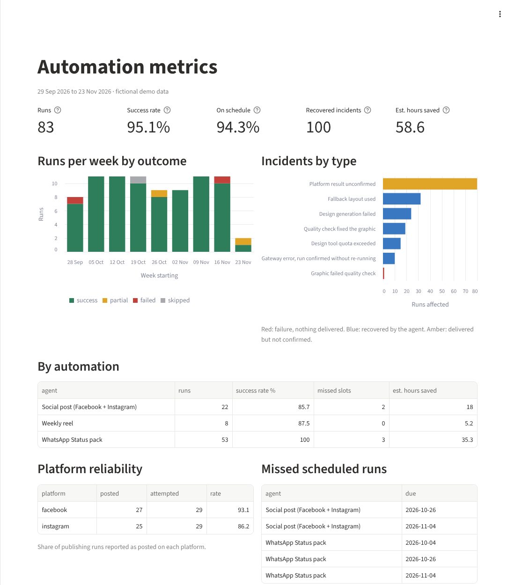
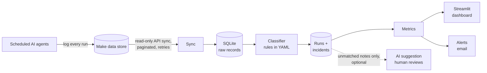

# Automation metrics dashboard

[](https://github.com/Cngima/automation-metrics-dashboard/actions/workflows/ci.yml)

Measures scheduled AI automations the way an operations lead would: how often they run, how often they succeed, what goes wrong, which problems the agents recover from on their own, which scheduled runs never happened, and how much manual time they save.

I built it to monitor the AI agents that run marketing for **Lynn Resumes**, my CV writing business ([how those agents work](https://github.com/Cngima/lynn-resumes-automation)). Three scheduled Claude agents create and publish social posts, a weekly reel and a daily WhatsApp Status pack, and log every run to a Make data store. This project reads that log (read-only), classifies each run and turns it into the metrics below.



*The public demo uses a fictional dataset; real run logs stay private.*

## What it measures

| Metric | Definition |
|---|---|
| Runs | Logged runs in the period, by automation and outcome (success, partial, failed, skipped) |
| Success rate | Successful runs as a share of runs attempted (owner-skipped runs excluded) |
| On schedule | Scheduled slots that have a logged run. Weekly automations are covered by a run anywhere in that week |
| Missed scheduled runs | Each slot with no run, with its due date, so scheduler failures are visible |
| Incidents | Problems found in each run's notes, classified as **failure** (nothing delivered), **recovered** (the agent handled it, e.g. a fallback layout or a gateway error confirmed without re-running) or **warning** (delivered but not confirmed) |
| Platform reliability | Share of publishing runs reported as posted on each platform |
| Estimated hours saved | Successful runs x an assumed number of manual minutes per automation. The assumptions sit in [`config/agents.yaml`](config/agents.yaml) and are shown on the dashboard, so the figure is never a hidden claim |

## How it works



1. **Sync (read-only).** `amd sync` pulls every record from the data store through the Make API, following pagination and retrying with exponential backoff on rate limits and server errors. It only ever sends GET requests. Sync is incremental: each record's content hash is stored, and only new or changed records are reprocessed. Every sync is logged.
2. **Classify.** Each record becomes a run (which automation, which outcome) or is ignored if it's a settings, reference or future-planned record. Incident rules in [`config/incident_rules.yaml`](config/incident_rules.yaml) are regular expressions matched against the run notes. When the rules change, `amd rebuild` re-classifies everything from the stored raw records, with no need to sync again.
3. **Measure.** [`metrics.py`](src/automation_metrics/metrics.py) computes the KPIs, weekly outcomes, incident breakdown, platform reliability and the expected-versus-actual schedule.
4. **Show and alert.** The Streamlit dashboard filters by period and automation. `amd alerts` flags two failed runs in a row for any automation, or a scheduled slot with no run, and can email them.
5. **AI only where rules fall short (optional, off by default).** `amd unclassified` lists notes that no rule matched. With `--ai claude_code` (the Claude Code CLI on your existing Claude plan, no API key) or `--ai ollama` (a local model), it suggests a category for a person to review and turn into a rule. AI never writes to the data.

## Quick start (demo data, no accounts needed)

```bash
git clone https://github.com/Cngima/automation-metrics-dashboard.git
cd automation-metrics-dashboard
python -m venv .venv
# Windows: .venv\Scripts\activate    macOS/Linux: source .venv/bin/activate
pip install -e ".[dev]"

amd demo                                    # load the fictional dataset
amd summary --demo --end 2026-11-23         # KPIs in the terminal
streamlit run dashboard/app.py -- --demo    # the dashboard
pytest
```

## Using it with real data

1. Copy `.env.example` to `.env` and add a Make API token with read-only scopes and your data store ID. `.env` is git-ignored.
2. `amd sync` then `streamlit run dashboard/app.py`. The dashboard uses your private database in `data/private/` (also git-ignored) when it exists, and the demo otherwise.
3. Edit `config/agents.yaml` to describe your own automations: which record keys belong to which agent, their schedules, and your manual-time assumptions.
4. Optional: schedule `amd sync` and `amd alerts --send` daily (Windows Task Scheduler or cron), with SMTP settings in `.env` for email alerts.

## Project layout

```
src/automation_metrics/
  make_client.py  read-only Make API client: pagination, retries, backoff, clear errors
  store.py        SQLite schema, incremental upsert by content hash, sync log
  classify.py     records to runs and incidents, driven by the YAML rules
  metrics.py      KPIs, weekly outcomes, incidents, platform reliability, schedule coverage
  alerts.py       consecutive failures and missed slots; optional email
  ai.py           optional AI suggestions for unmatched notes (Claude Code CLI or Ollama)
  demo.py         deterministic fictional dataset
  cli.py          the amd command
dashboard/app.py  Streamlit dashboard
config/           automations, schedules, time assumptions and incident rules
tests/            35 tests: API client (mocked), classification, storage, metrics, alerts, dashboard render
```

## Limitations

- Platform results depend on what the automations log. On Make's free plan, per-module results aren't readable through the API, so a run can be "posted" without confirmation; the dashboard reports these as warnings, not successes it can't prove.
- Hours saved is an estimate built on stated assumptions, not a measurement.
- Incident classification is only as good as the rules; `amd unclassified` exists to find the gaps.

Built by Carol Njogu with Claude Code. MIT licence.
